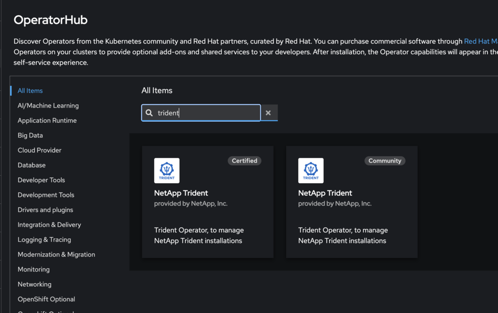
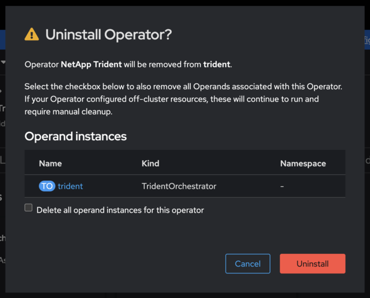

= Passez à l’opérateur Trident certifié OpenShift
:hardbreaks:
:allow-uri-read: 
:icons: font
:imagesdir: ../media/

[role="lead"]
Vous pouvez passer à l’opérateur Trident certifié Red Hat OpenShift depuis l’opérateur communautaire, une installation basée sur Helm ou un opérateur déployé manuellement. Le processus pour chaque méthode consiste à désinstaller l’opérateur existant, puis à installer l’opérateur certifié en utilisant le OperatorHub.

.Avant de commencer
Avant de commencer l'installation, link:../trident-get-started/requirements.html["Préparez votre environnement pour l'installation de Trident"].

IMPORTANT: Ne supprimez pas la `TridentOrchestrator` ressource personnalisée (CR) lors du processus de désinstallation. La `TridentOrchestrator` CR conserve la configuration de votre backend et de votre classe de stockage, ce qui est requis après l'installation de l'opérateur certifié.

[[switch-from-the-community-operator]]
== Passez de l'opérateur communautaire

.Étapes
. Utilisez la console OpenShift pour naviguer vers le OperatorHub.
+

. Trouvez l’opérateur communautaire NetApp Trident.
+

+

WARNING: Ne sélectionnez pas *Supprimer toutes les instances d'opérande de cet opérateur*.

. Cliquez sur *Uninstall*.
. Une fois la désinstallation terminée, passez à <<install-certified,Installez l’opérateur certifié OpenShift>>.

[[switch-from-a-helm-based-operator-installation]]
== Passer d'une installation opérateur basée sur Helm

.Étapes
. Répertoriez la version Helm de votre installation Trident :
+
[listing]
----
helm ls -n trident
----
. Désinstallez la version Helm :
+
[listing]
----
helm uninstall <release-name> -n trident
----
. Une fois la désinstallation terminée, passez à <<install-certified,Installez l’opérateur certifié OpenShift>>.

[[switch-from-a-manually-deployed-operator]]
== Passer d’un opérateur déployé manuellement

Si vous avez installé Trident en déployant manuellement l’opérateur à l’aide d’un  `bundle.yaml` du package d’installation, supprimez-le en supprimant le même manifeste.

.Étapes
. Supprimez le déploiement de l'opérateur à l'aide du manifeste du bundle :
+
[listing]
----
kubectl delete -f deploy/bundle.yaml -n trident
----
. Une fois la désinstallation terminée, passez à <<install-certified,Installez l’opérateur certifié OpenShift>>.

[[install-the-openshift-certified-operator]]
[[install-certified]]
== Installez l’opérateur certifié OpenShift

.Étapes
. Accédez au Red Hat OperatorHub.
. Recherchez et sélectionnez l’opérateur NetApp Trident.
+

. Suivez les instructions à l'écran pour installer l'opérateur.

[[verification]]
== Vérification

* Vérifiez dans la console OperatorHub pour vous assurer que le nouvel opérateur certifié a bien été installé avec succès.

