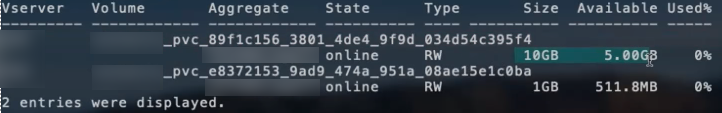

= Options et exemples de configuration NAS ONTAP
:hardbreaks:
:allow-uri-read: 
:icons: font
:imagesdir: ../media/

[role="lead"]
Apprenez à créer et à utiliser des pilotes NAS ONTAP avec votre installation Trident. Cette section fournit des exemples de configuration backend et des détails pour le mappage des backends à StorageClasses. À compter de la version 25.10, NetApp Trident prend en charge link:https://docs.netapp.com/us-en/ontap-afx/index.html["NetApp AFX systèmes de stockage"^]. NetApp AFX les systèmes de stockage diffèrent des autres systèmes basés sur ONTAP (ASA, AFF et FAS) dans l’implémentation de leur couche de stockage.

NOTE: Seul le  `ontap-nas` driver (avec le protocole NFS) est pris en charge pour les systèmes NetApp AFX ; le protocole SMB n’est pas pris en charge.

== Options de configuration du backend

Dans la configuration du backend Trident, il n'est pas nécessaire de préciser que votre système est un NetApp AFX storage system. Lorsque vous sélectionnez `ontap-nas` comme `storageDriverName`, Trident détecte automatiquement le système de stockage AFX. Certains paramètres de configuration du backend ne sont pas applicables aux systèmes de stockage AFX.

Le tableau suivant présente les options de configuration du backend :

[cols="1,3,2"]
|===
| Paramètre | Description | Défaut 

| `version` |  | Toujours 1 

| `storageDriverName`  a| 
Nom du pilote de stockage

NOTE: Pour les systèmes NetApp AFX, seul `ontap-nas` est pris en charge.
| `ontap-nas`, `ontap-nas-economy`, ou `ontap-nas-flexgroup` 

| `backendName` | Nom personnalisé ou le stockage backend | Nom du pilote + "_" + dataLIF 

| `managementLIF` | Adresse IP d’un cluster ou d’une LIF de gestion SVM. Un nom de domaine complet (FQDN) peut être spécifié. Il est possible de configurer l’utilisation d’adresses IPv6 si Trident a été installé avec l’option IPv6. Les adresses IPv6 doivent être définies entre crochets, comme  `[28e8:d9fb:a825:b7bf:69a8:d02f:9e7b:3555]`. Pour une transition en douceur MetroCluster, consultez le <<mcc-best>>. | "10.0.0.1", "[2001:1234:abcd::fefe]" 

| `dataLIF` | Adresse IP de l’interface logique de protocole (LIF). NetApp recommande de spécifier `dataLIF`. Si elle n’est pas fournie, Trident récupère les dataLIF depuis la SVM. Vous pouvez spécifier un nom de domaine complet (FQDN) à utiliser pour les opérations de montage NFS, ce qui vous permet de créer un DNS à répartition de charge (round-robin) entre plusieurs dataLIF. Peut être modifié après la configuration initiale. Consultez . Il est possible de configurer l’utilisation d’adresses IPv6 si Trident a été installé avec l’option IPv6. Les adresses IPv6 doivent être définies entre crochets, comme  `[28e8:d9fb:a825:b7bf:69a8:d02f:9e7b:3555]`. *Omettre pour MetroCluster.* Voir le <<mcc-best>>. | Adresse spécifiée ou dérivée de la SVM, si non spécifiée (non recommandé) 

| `svm` | Machine virtuelle de stockage à utiliser *Omettre pour MetroCluster.* Voir le <<mcc-best>>. | Dérivé si un SVM `managementLIF` est spécifié 

| `autoExportPolicy` | Activer la création et la mise à jour automatiques des règles d'export [Booléen]. En utilisant les options `autoExportPolicy` et `autoExportCIDRs`, Trident peut gérer les règles d'export automatiquement. | false 

| `autoExportCIDRs` | Liste des CIDR pour filtrer les adresses IP des nœuds Kubernetes lorsque `autoExportPolicy` est activé. En utilisant les options `autoExportPolicy` et `autoExportCIDRs`, Trident peut gérer les règles d'export automatiquement. | ["0.0.0.0/0", "::/0"]` 

| `labels` | Ensemble d'étiquettes arbitraires au format JSON à appliquer aux volumes | "" 

| `clientCertificate` | Valeur encodée en Base64 du certificat client. Utilisé pour l'authentification par certificat | "" 

| `clientPrivateKey` | Valeur encodée en Base64 de la clé privée du client. Utilisé pour l'authentification par certificat | "" 

| `trustedCACertificate` | Valeur encodée en Base64 du certificat d'autorité de certification de confiance. Facultatif. Utilisé pour l'authentification par certificat | "" 

| `username` | Nom d'utilisateur pour se connecter au cluster/SVM. Utilisé pour l'authentification par identifiants. Pour l'authentification Active Directory, voir link:../trident-use/ontap-san-examples.html#authenticate-trident-to-a-backend-svm-using-active-directory-credentials["Authentifier Trident auprès d'un SVM backend à l'aide des identifiants Active Directory"]. |  

| `password` | Mot de passe pour se connecter au cluster/SVM. Utilisé pour l'authentification par identifiants. Pour l'authentification Active Directory, voir link:../trident-use/ontap-san-examples.html#authenticate-trident-to-a-backend-svm-using-active-directory-credentials["Authentifier Trident auprès d'un SVM backend à l'aide des identifiants Active Directory"]. |  

| `storagePrefix`  a| 
Préfixe utilisé lors du provisionnement de nouveaux volumes dans la SVM. Ne peut pas être modifié après sa définition

NOTE: Lors de l'utilisation d'ontap-nas-economy et d'un storagePrefix de 24 caractères ou plus, les qtrees n'auront pas le préfixe de stockage intégré, bien qu'il soit présent dans le nom du volume.
| "Trident" 

| `aggregate`  a| 
Agrégat pour le provisionnement (facultatif ; s'il est défini, il doit être attribué à la SVM). Pour le  `ontap-nas-flexgroup` driver, cette option est ignorée. S'il n'est pas attribué, n'importe quel agrégat disponible peut être utilisé pour provisionner un FlexGroup volume.

NOTE: Lorsqu'un agrégat est mis à jour dans SVM, il est automatiquement mis à jour dans Trident par interrogation de SVM, sans qu'il soit nécessaire de redémarrer le contrôleur Trident. Si vous avez configuré un agrégat spécifique dans Trident pour provisionner des volumes, si l'agrégat est renommé ou déplacé hors de la SVM, le backend passera en état d'échec dans Trident lors de l'interrogation de l'agrégat SVM. Vous devez soit changer l'agrégat pour un qui est présent sur la SVM, soit le supprimer complètement pour remettre le backend en ligne.

*Ne pas spécifier pour les systèmes de stockage AFX.*
 a| 
""

| `limitAggregateUsage` | L'approvisionnement échoue si l'utilisation dépasse ce pourcentage. *Ne s'applique pas à Amazon FSx pour ONTAP*. *Ne pas spécifier pour les systèmes de stockage AFX.* | "" (non appliqué par défaut) 

| flexgroupAggregateList  a| 
Liste des agrégats à provisionner (facultatif ; si défini, doit être affecté au SVM). Tous les agrégats affectés au SVM sont utilisés pour provisionner un FlexGroup volume. Pris en charge par le pilote de stockage *ontap-nas-flexgroup*.

NOTE: Lorsque la liste d'agrégats est mise à jour dans SVM, la liste est mise à jour automatiquement dans Trident par interrogation de SVM, sans qu'il soit nécessaire de redémarrer le contrôleur Trident. Lorsque vous avez configuré une liste d'agrégats spécifique dans Trident pour le provisionnement de volumes, si la liste d'agrégats est renommée ou déplacée hors de SVM, le backend passera à l'état d'échec dans Trident lors de l'interrogation de l'agrégat SVM. Vous devez soit modifier la liste d'agrégats pour en choisir une présente sur le SVM, soit la supprimer complètement afin de remettre le backend en ligne.
| "" 

| `limitVolumeSize` | L'approvisionnement échoue si la taille du volume demandée dépasse cette valeur. | "" (non appliqué par défaut) 

| `debugTraceFlags` | Options de débogage à utiliser lors du dépannage. Exemple, {"api":false, "method":true} Ne pas utiliser `debugTraceFlags` sauf si vous effectuez un dépannage et avez besoin d’un journal détaillé. | null 

| `nasType` | Configurez la création de volumes NFS ou SMB. Les options sont `nfs`, `smb` ou null. La valeur null correspond par défaut à des volumes NFS. *Si spécifié, définissez toujours sur  `nfs` pour les systèmes de stockage AFX*. | `nfs` 

| `nfsMountOptions` | Liste d'options de montage NFS séparées par des virgules. Les options de montage pour les volumes persistants Kubernetes sont généralement spécifiées dans les classes de stockage, mais si aucune option de montage n'est spécifiée dans une classe de stockage, Trident utilisera les options de montage spécifiées dans le fichier de configuration du backend de stockage. Si aucune option de montage n'est spécifiée ni dans la classe de stockage ni dans le fichier de configuration, Trident n'appliquera aucune option de montage au volume persistant associé. | "" 

| `qtreesPerFlexvol` | Nombre maximal de Qtrees par FlexVol, doit être compris dans la plage [50, 300] | "200" 

| `smbShare` | Vous pouvez spécifier l'une des options suivantes : le nom d'un partage SMB créé à l'aide de la console de gestion Microsoft ou de l'interface de ligne de commande ONTAP ; un nom pour permettre à Trident de créer le partage SMB ; ou vous pouvez laisser le paramètre vide pour empêcher l'accès partagé aux volumes. Ce paramètre est facultatif pour ONTAP sur site. Ce paramètre est obligatoire pour Amazon FSx for ONTAP backends et ne peut pas être vide. | `smb-share` 

| `useREST` | Paramètre booléen à utiliser pour les API REST ONTAP.  `useREST` Lorsqu'il est défini sur `true`, Trident utilise les API REST ONTAP pour communiquer avec le backend ; lorsqu'il est défini sur `false`, Trident utilise les appels ONTAPI (ZAPI) pour communiquer avec le backend. Cette fonctionnalité nécessite ONTAP 9.11.1 ou une version ultérieure. De plus, le rôle de connexion ONTAP utilisé doit avoir accès à l'application  `ontapi`. Cela est satisfait par les rôles prédéfinis  `vsadmin` et  `cluster-admin`. À partir de la version Trident 24.06 et ONTAP 9.15.1 ou version ultérieure,  `useREST` est défini sur  `true` par défaut ; modifiez  `useREST` sur  `false` pour utiliser les appels ONTAPI (ZAPI). *Si spécifié, définissez toujours sur  `true` pour les systèmes de stockage AFX*. | `true` pour ONTAP 9.15.1 ou version ultérieure, sinon  `false`. 

| `limitVolumePoolSize` | Taille maximale requise de FlexVol lors de l'utilisation de Qtrees dans le backend ontap-nas-economy. | "" (non appliqué par défaut) 

| `denyNewVolumePools` | Empêche  `ontap-nas-economy` les serveurs backend de créer de nouveaux volumes FlexVol pour y stocker leurs Qtrees. Seuls les FlexVol® préexistants sont utilisés pour le provisionnement de nouveaux PV. |  

| `adAdminUser` | Utilisateur ou groupe d'utilisateurs administrateur Active Directory disposant d'un accès complet aux partages SMB. Utilisez ce paramètre pour accorder des droits d'administrateur sur le partage SMB avec un contrôle total. |  
|===

== Options de configuration backend pour le provisionnement des volumes

Vous pouvez contrôler le provisionnement par défaut à l'aide de ces options dans la section  `defaults` de la configuration. Pour un exemple, consultez les exemples de configuration ci-dessous.

[cols="1,3,2"]
|===
| Paramètre | Description | Défaut 

| `spaceAllocation` | Allocation d'espace pour les Qtrees | "true" 

| `spaceReserve` | Mode de réservation d'espace ; "none" (fin) ou "volume" (épais) | "none" 

| `snapshotPolicy` | Stratégie de snapshot à utiliser | "none" 

| `qosPolicy` | Groupe de règles QoS à attribuer aux volumes créés. Choisissez l’un des deux, qosPolicy ou adaptiveQosPolicy, par pool de stockage/backend | "" 

| `adaptiveQosPolicy` | Groupe de règles QoS adaptatives à attribuer aux volumes créés. Choisissez l'un de qosPolicy ou adaptiveQosPolicy par pool de stockage/backend. Non pris en charge par ontap-nas-economy. | "" 

| `snapshotReserve` | Pourcentage du volume réservé aux instantanés | "0" si  `snapshotPolicy` est "aucun", sinon "" 

| `splitOnClone` | Séparer un clone de son parent lors de sa création | "false" 

| `encryption` | Activez le chiffrement de volume NetApp (NVE) sur le nouveau volume ; la valeur par défaut est  `false`. NVE doit être sous licence et activé sur le cluster pour utiliser cette option. Si NAE est activé sur le backend, tout volume provisionné dans Trident sera activé pour NAE. Pour plus d'informations, consultez : link:../trident-reco/security-reco.html["Comment Trident fonctionne avec NVE et NAE"]. | "false" 

| `tieringPolicy` | Politique de hiérarchisation à utiliser « none » |  

| `unixPermissions` | Mode pour les nouveaux volumes | "777" pour les volumes NFS; vide (non applicable) pour les volumes SMB 

| `snapshotDir` | Contrôle l'accès au `.snapshot` répertoire | `true`, `false` (Défini explicitement). 

| `exportPolicy` | Règles d'export à utiliser | "default" 

| `securityStyle` | Style de sécurité pour les nouveaux volumes. NFS prend en charge  `mixed` et  `unix` styles de sécurité. SMB prend en charge  `mixed` et  `ntfs` styles de sécurité. | La valeur par défaut de NFS est `unix`. La valeur par défaut de SMB est `ntfs`. 

| `nameTemplate` | Modèle pour créer des noms de volumes personnalisés. | "" 
|===

NOTE: L'utilisation des groupes de règles QoS avec Trident requiert ONTAP 9.8 ou une version ultérieure. Vous devez utiliser un groupe de règles QoS non partagé et vous assurer que le groupe de règles est appliqué individuellement à chaque composant. Un groupe de règles QoS partagé impose une limite au débit total de toutes les charges de travail.

=== Exemples de provisionnement de volumes

Voici un exemple avec des valeurs par défaut définies :

[source, yaml]
----
---
version: 1
storageDriverName: ontap-nas
backendName: customBackendName
managementLIF: 10.0.0.1
dataLIF: 10.0.0.2
labels:
  k8scluster: dev1
  backend: dev1-nasbackend
svm: trident_svm
username: cluster-admin
password: <password>
limitAggregateUsage: 80%
limitVolumeSize: 50Gi
nfsMountOptions: nfsvers=4
debugTraceFlags:
  api: false
  method: true
defaults:
  spaceReserve: volume
  qosPolicy: premium
  exportPolicy: myk8scluster
  snapshotPolicy: default
  snapshotReserve: "10"
----
Pour  `ontap-nas` et  `ontap-nas-flexgroups`, Trident utilise désormais un nouveau calcul afin de garantir que le FlexVol soit correctement dimensionné avec le pourcentage de snapshotReserve et le PVC. Lorsque l'utilisateur demande un PVC, Trident crée le FlexVol initial avec plus d'espace en utilisant le nouveau calcul. Ce calcul garantit que l'utilisateur reçoit l'espace inscriptible qu'il a demandé dans le PVC, et non moins que ce qu'il a demandé. Avant la version v21.07, lorsque l'utilisateur demandait un PVC (par exemple, 5 Gio), avec le snapshotReserve à 50 pour cent, il n'obtenait que 2,5 Gio d'espace inscriptible. Cela s'explique par le fait que ce que l'utilisateur demandait était le volume entier et  `snapshotReserve` est un pourcentage de celui-ci. Avec Trident 21.07, ce que l'utilisateur demande est l'espace inscriptible et Trident définit le nombre  `snapshotReserve` comme le pourcentage du volume entier. Cela ne s'applique pas à  `ontap-nas-economy`. Voir l'exemple suivant pour comprendre comment cela fonctionne :

Le calcul est le suivant :

[listing]
----
Total volume size = <PVC requested size> / (1 - (<snapshotReserve percentage> / 100))
----
Pour snapshotReserve = 50 %, et une demande PVC = 5 Gio, la taille totale du volume est de 5 / 0,5 = 10 Gio et la taille disponible est de 5 Gio, ce qui correspond à la demande de l'utilisateur dans la demande PVC. La commande  `volume show` devrait afficher des résultats similaires à cet exemple :

Les backends existants issus d'installations précédentes provisionneront les volumes comme expliqué ci-dessus lors de la mise à niveau de Trident. Pour les volumes que vous avez créés avant la mise à niveau, vous devez redimensionner leurs volumes pour que la modification soit prise en compte. Par exemple, un PVC de 2 Gio avec `snapshotReserve=50` aboutissait auparavant à un volume offrant 1 Gio d'espace accessible en écriture. En redimensionnant le volume à 3 Gio, par exemple, l'application disposera de 3 Gio d'espace accessible en écriture sur un volume de 6 Gio.

== Exemples de configuration minimale

Les exemples suivants présentent des configurations de base qui laissent la plupart des paramètres par défaut. C'est la manière la plus simple de définir un backend.

NOTE: Si vous utilisez Amazon FSx sur NetApp ONTAP avec Trident, la recommandation est de spécifier les noms DNS des LIF au lieu des adresses IP.

.Exemple d'économie NAS ONTAP
[%collapsible]
====
[source, yaml]
----
---
version: 1
storageDriverName: ontap-nas-economy
managementLIF: 10.0.0.1
dataLIF: 10.0.0.2
svm: svm_nfs
username: vsadmin
password: password
----
====
.Exemple de FlexGroup NAS ONTAP
[%collapsible]
====
[source, yaml]
----
---
version: 1
storageDriverName: ontap-nas-flexgroup
managementLIF: 10.0.0.1
dataLIF: 10.0.0.2
svm: svm_nfs
username: vsadmin
password: password
----
====
.Exemple MetroCluster
[#mcc-best%collapsible]
====
Vous pouvez configurer le backend pour éviter d'avoir à mettre à jour manuellement la définition du backend après le basculement et le retour en arrière pendant link:../trident-reco/backup.html#svm-replication-and-recovery["Réplication et récupération de SVM"].

Pour une transition et un retour en arrière sans heurt, spécifiez le SVM en utilisant  `managementLIF` et omettez les  `dataLIF` et  `svm` paramètres. Par exemple :

[source, yaml]
----
---
version: 1
storageDriverName: ontap-nas
managementLIF: 192.168.1.66
username: vsadmin
password: password
----
====
.Exemple de volumes SMB
[%collapsible]
====
[source, yaml]
----
---
version: 1
backendName: ExampleBackend
storageDriverName: ontap-nas
managementLIF: 10.0.0.1
nasType: smb
securityStyle: ntfs
unixPermissions: ""
dataLIF: 10.0.0.2
svm: svm_nfs
username: vsadmin
password: password
----
====
.Exemple d'authentification par certificat
[%collapsible]
====
Voici un exemple de configuration minimale du backend. `clientCertificate`, `clientPrivateKey`, et `trustedCACertificate` (facultatif, si vous utilisez une autorité de certification de confiance) sont renseignés dans `backend.json` et prennent respectivement les valeurs encodées en base64 du certificat client, de la clé privée et du certificat de l'autorité de certification de confiance.

[source, yaml]
----
---
version: 1
backendName: DefaultNASBackend
storageDriverName: ontap-nas
managementLIF: 10.0.0.1
dataLIF: 10.0.0.15
svm: nfs_svm
clientCertificate: ZXR0ZXJwYXB...ICMgJ3BhcGVyc2
clientPrivateKey: vciwKIyAgZG...0cnksIGRlc2NyaX
trustedCACertificate: zcyBbaG...b3Igb3duIGNsYXNz
storagePrefix: myPrefix_
----
====
.Exemple de règles d'export automatique
[%collapsible]
====
Cet exemple vous montre comment vous pouvez demander à Trident d'utiliser des règles d'export dynamiques pour créer et gérer automatiquement la règle d'export. Cela fonctionne de la même manière pour les `ontap-nas-economy` et `ontap-nas-flexgroup` pilotes.

[source, yaml]
----
---
version: 1
storageDriverName: ontap-nas
managementLIF: 10.0.0.1
dataLIF: 10.0.0.2
svm: svm_nfs
labels:
  k8scluster: test-cluster-east-1a
  backend: test1-nasbackend
autoExportPolicy: true
autoExportCIDRs:
- 10.0.0.0/24
username: admin
password: password
nfsMountOptions: nfsvers=4
----
====
.Exemple d'adresses IPv6
[%collapsible]
====
Cet exemple montre  `managementLIF` l'utilisation d'une adresse IPv6.

[source, yaml]
----
---
version: 1
storageDriverName: ontap-nas
backendName: nas_ipv6_backend
managementLIF: "[5c5d:5edf:8f:7657:bef8:109b:1b41:d491]"
labels:
  k8scluster: test-cluster-east-1a
  backend: test1-ontap-ipv6
svm: nas_ipv6_svm
username: vsadmin
password: password
----
====
.Exemple d'utilisation d'Amazon FSx for ONTAP avec des volumes SMB
[%collapsible]
====
Le  `smbShare`paramètre est requis pour FSx for ONTAP utilisant des volumes SMB.

[source, yaml]
----
---
version: 1
backendName: SMBBackend
storageDriverName: ontap-nas
managementLIF: example.mgmt.fqdn.aws.com
nasType: smb
dataLIF: 10.0.0.15
svm: nfs_svm
smbShare: smb-share
clientCertificate: ZXR0ZXJwYXB...ICMgJ3BhcGVyc2
clientPrivateKey: vciwKIyAgZG...0cnksIGRlc2NyaX
trustedCACertificate: zcyBbaG...b3Igb3duIGNsYXNz
storagePrefix: myPrefix_
----
====
.Exemple de configuration du backend avec nameTemplate
[%collapsible]
====
[source, yaml]
----
---
version: 1
storageDriverName: ontap-nas
backendName: ontap-nas-backend
managementLIF: <ip address>
svm: svm0
username: <admin>
password: <password>
defaults:
  nameTemplate: "{{.volume.Name}}_{{.labels.cluster}}_{{.volume.Namespace}}_{{.vo\
    lume.RequestName}}"
labels:
  cluster: ClusterA
  PVC: "{{.volume.Namespace}}_{{.volume.RequestName}}"
----
====

== Exemples de backends avec pools virtuels

Dans les exemples de fichiers de définition de backend ci-dessous, des valeurs par défaut spécifiques sont définies pour tous les pools de stockage, comme  `spaceReserve` à aucun,  `spaceAllocation` à faux, et  `encryption` à faux. Les pools virtuels sont définis dans la section storage.

Trident définit les étiquettes de provisionnement dans le champ « Commentaires ». Les commentaires sont définis sur FlexVol pour  `ontap-nas` ou sur FlexGroup pour  `ontap-nas-flexgroup`. Trident copie toutes les étiquettes présentes sur un pool virtuel vers le volume de stockage lors du provisionnement. Pour plus de simplicité, les administrateurs de stockage peuvent définir des étiquettes par pool virtuel et regrouper les volumes par étiquette.

Dans ces exemples, certains pools de stockage définissent leurs propres  `spaceReserve`,  `spaceAllocation`, et  `encryption` valeurs, et certains pools remplacent les valeurs par défaut.

.Exemple NAS ONTAP
[%collapsible%open]
====
[source, yaml]
----
---
version: 1
storageDriverName: ontap-nas
managementLIF: 10.0.0.1
svm: svm_nfs
username: admin
password: <password>
nfsMountOptions: nfsvers=4
defaults:
  spaceReserve: none
  encryption: "false"
  qosPolicy: standard
labels:
  store: nas_store
  k8scluster: prod-cluster-1
region: us_east_1
storage:
  - labels:
      app: msoffice
      cost: "100"
    zone: us_east_1a
    defaults:
      spaceReserve: volume
      encryption: "true"
      unixPermissions: "0755"
      adaptiveQosPolicy: adaptive-premium
  - labels:
      app: slack
      cost: "75"
    zone: us_east_1b
    defaults:
      spaceReserve: none
      encryption: "true"
      unixPermissions: "0755"
  - labels:
      department: legal
      creditpoints: "5000"
    zone: us_east_1b
    defaults:
      spaceReserve: none
      encryption: "true"
      unixPermissions: "0755"
  - labels:
      app: wordpress
      cost: "50"
    zone: us_east_1c
    defaults:
      spaceReserve: none
      encryption: "true"
      unixPermissions: "0775"
  - labels:
      app: mysqldb
      cost: "25"
    zone: us_east_1d
    defaults:
      spaceReserve: volume
      encryption: "false"
      unixPermissions: "0775"

----
====
.Exemple de NAS ONTAP FlexGroup
[%collapsible%open]
====
[source, yaml]
----
---
version: 1
storageDriverName: ontap-nas-flexgroup
managementLIF: 10.0.0.1
svm: svm_nfs
username: vsadmin
password: <password>
defaults:
  spaceReserve: none
  encryption: "false"
labels:
  store: flexgroup_store
  k8scluster: prod-cluster-1
region: us_east_1
storage:
  - labels:
      protection: gold
      creditpoints: "50000"
    zone: us_east_1a
    defaults:
      spaceReserve: volume
      encryption: "true"
      unixPermissions: "0755"
  - labels:
      protection: gold
      creditpoints: "30000"
    zone: us_east_1b
    defaults:
      spaceReserve: none
      encryption: "true"
      unixPermissions: "0755"
  - labels:
      protection: silver
      creditpoints: "20000"
    zone: us_east_1c
    defaults:
      spaceReserve: none
      encryption: "true"
      unixPermissions: "0775"
  - labels:
      protection: bronze
      creditpoints: "10000"
    zone: us_east_1d
    defaults:
      spaceReserve: volume
      encryption: "false"
      unixPermissions: "0775"

----
====
.Exemple d'économie NAS ONTAP
[%collapsible%open]
====
[source, yaml]
----
---
version: 1
storageDriverName: ontap-nas-economy
managementLIF: 10.0.0.1
svm: svm_nfs
username: vsadmin
password: <password>
defaults:
  spaceReserve: none
  encryption: "false"
labels:
  store: nas_economy_store
region: us_east_1
storage:
  - labels:
      department: finance
      creditpoints: "6000"
    zone: us_east_1a
    defaults:
      spaceReserve: volume
      encryption: "true"
      unixPermissions: "0755"
  - labels:
      protection: bronze
      creditpoints: "5000"
    zone: us_east_1b
    defaults:
      spaceReserve: none
      encryption: "true"
      unixPermissions: "0755"
  - labels:
      department: engineering
      creditpoints: "3000"
    zone: us_east_1c
    defaults:
      spaceReserve: none
      encryption: "true"
      unixPermissions: "0775"
  - labels:
      department: humanresource
      creditpoints: "2000"
    zone: us_east_1d
    defaults:
      spaceReserve: volume
      encryption: "false"
      unixPermissions: "0775"

----
====

== Map backends vers StorageClasses

Les définitions de StorageClass suivantes font référence à <<Exemples de backends avec pools virtuels>>. En utilisant le champ  `parameters.selector`, chaque StorageClass indique quels pools virtuels peuvent être utilisés pour héberger un volume. Le volume possédera les aspects définis dans le pool virtuel choisi.

* Le `protection-gold` StorageClass sera associé au premier et au deuxième pool virtuel dans le `ontap-nas-flexgroup` backend. Ce sont les seuls pools offrant une protection de niveau or.
+
[source, yaml]
----
apiVersion: storage.k8s.io/v1
kind: StorageClass
metadata:
  name: protection-gold
provisioner: csi.trident.netapp.io
parameters:
  selector: "protection=gold"
  fsType: "ext4"
----
* Le `protection-not-gold` StorageClass sera associé au troisième et au quatrième pool virtuel dans le `ontap-nas-flexgroup` backend. Ce sont les seuls pools offrant un niveau de protection autre que gold.
+
[source, yaml]
----
apiVersion: storage.k8s.io/v1
kind: StorageClass
metadata:
  name: protection-not-gold
provisioner: csi.trident.netapp.io
parameters:
  selector: "protection!=gold"
  fsType: "ext4"
----
* Le `app-mysqldb` StorageClass correspondra au quatrième pool virtuel dans le `ontap-nas` backend. Il s'agit du seul pool offrant une configuration de pool de stockage pour les applications de type mysqldb.
+
[source, yaml]
----
apiVersion: storage.k8s.io/v1
kind: StorageClass
metadata:
  name: app-mysqldb
provisioner: csi.trident.netapp.io
parameters:
  selector: "app=mysqldb"
  fsType: "ext4"
----
* Le `protection-silver-creditpoints-20k` StorageClass sera associé au troisième pool virtuel dans le `ontap-nas-flexgroup` backend. Il s'agit du seul pool offrant une protection de niveau argent et 20000 points de crédit.
+
[source, yaml]
----
apiVersion: storage.k8s.io/v1
kind: StorageClass
metadata:
  name: protection-silver-creditpoints-20k
provisioner: csi.trident.netapp.io
parameters:
  selector: "protection=silver; creditpoints=20000"
  fsType: "ext4"
----
* Le `creditpoints-5k` StorageClass correspondra au troisième pool virtuel dans le `ontap-nas` backend et au deuxième pool virtuel dans le `ontap-nas-economy` backend. Ce sont les seuls pools proposant 5000 points de crédit.
+
[source, yaml]
----
apiVersion: storage.k8s.io/v1
kind: StorageClass
metadata:
  name: creditpoints-5k
provisioner: csi.trident.netapp.io
parameters:
  selector: "creditpoints=5000"
  fsType: "ext4"
----

Trident déterminera quel pool virtuel est sélectionné et s'assurera que l'exigence de stockage est respectée.

== Mise à jour `dataLIF` après la configuration initiale

Vous pouvez modifier le dataLIF après la configuration initiale en exécutant la commande suivante pour fournir le nouveau fichier JSON backend avec le dataLIF mis à jour.

[listing]
----
tridentctl update backend <backend-name> -f <path-to-backend-json-file-with-updated-dataLIF>
----

NOTE: Si des PVC sont connectés à un ou plusieurs pods, vous devez mettre hors service tous les pods correspondants, puis les remettre en service afin que la nouvelle dataLIF prenne effet.

== Exemples de SMB sécurisés

=== Configuration du backend avec le pilote ontap-nas

[source, yaml]
----
apiVersion: trident.netapp.io/v1
kind: TridentBackendConfig
metadata:
  name: backend-tbc-ontap-nas
  namespace: trident
spec:
  version: 1
  storageDriverName: ontap-nas
  managementLIF: 10.0.0.1
  svm: svm2
  nasType: smb
  defaults:
    adAdminUser: tridentADtest
  credentials:
    name: backend-tbc-ontap-invest-secret
----

=== Configuration du backend avec le pilote ontap-nas-economy

[source, yaml]
----
apiVersion: trident.netapp.io/v1
kind: TridentBackendConfig
metadata:
  name: backend-tbc-ontap-nas
  namespace: trident
spec:
  version: 1
  storageDriverName: ontap-nas-economy
  managementLIF: 10.0.0.1
  svm: svm2
  nasType: smb
  defaults:
    adAdminUser: tridentADtest
  credentials:
    name: backend-tbc-ontap-invest-secret
----

=== Configuration du backend avec pool de stockage

[source, yaml]
----
apiVersion: trident.netapp.io/v1
kind: TridentBackendConfig
metadata:
  name: backend-tbc-ontap-nas
  namespace: trident
spec:
  version: 1
  storageDriverName: ontap-nas
  managementLIF: 10.0.0.1
  svm: svm0
  useREST: false
  storage:
  - labels:
      app: msoffice
    defaults:
      adAdminUser: tridentADuser
  nasType: smb
  credentials:
    name: backend-tbc-ontap-invest-secret

----

=== Exemple de classe de stockage avec le pilote ontap-nas

[source, yaml]
----
apiVersion: storage.k8s.io/v1
kind: StorageClass
metadata:
  name: ontap-smb-sc
  annotations:
    trident.netapp.io/smbShareAdUserPermission: change
    trident.netapp.io/smbShareAdUser: tridentADtest
parameters:
  backendType: ontap-nas
  csi.storage.k8s.io/node-stage-secret-name: smbcreds
  csi.storage.k8s.io/node-stage-secret-namespace: trident
  trident.netapp.io/nasType: smb
provisioner: csi.trident.netapp.io
reclaimPolicy: Delete
volumeBindingMode: Immediate
----

NOTE: Assurez-vous d'ajouter `annotations` pour activer le SMB sécurisé. Le SMB sécurisé ne fonctionne pas sans les annotations, quelles que soient les configurations définies dans le Backend ou le PVC.

=== Exemple de classe de stockage avec le pilote ontap-nas-economy

[source, yaml]
----
apiVersion: storage.k8s.io/v1
kind: StorageClass
metadata:
  name: ontap-smb-sc
  annotations:
    trident.netapp.io/smbShareAdUserPermission: change
    trident.netapp.io/smbShareAdUser: tridentADuser3
parameters:
  backendType: ontap-nas-economy
  csi.storage.k8s.io/node-stage-secret-name: smbcreds
  csi.storage.k8s.io/node-stage-secret-namespace: trident
  trident.netapp.io/nasType: smb
provisioner: csi.trident.netapp.io
reclaimPolicy: Delete
volumeBindingMode: Immediate
----

=== Exemple de PVC avec un seul utilisateur AD

[source, yaml]
----
apiVersion: v1
kind: PersistentVolumeClaim
metadata:
  name: my-pvc4
  namespace: trident
  annotations:
    trident.netapp.io/smbShareAccessControl: |
      change:
        - tridentADtest
      read:
        - tridentADuser
spec:
  accessModes:
    - ReadWriteOnce
  resources:
    requests:
      storage: 1Gi
  storageClassName: ontap-smb-sc
----

=== Exemple de PVC avec plusieurs utilisateurs AD

[source, yaml]
----
apiVersion: v1
kind: PersistentVolumeClaim
metadata:
  name: my-test-pvc
  annotations:
    trident.netapp.io/smbShareAccessControl: |
      full_control:
        - tridentTestuser
        - tridentuser
        - tridentTestuser1
        - tridentuser1
      change:
        - tridentADuser
        - tridentADuser1
        - tridentADuser4
        - tridentTestuser2
      read:
        - tridentTestuser2
        - tridentTestuser3
        - tridentADuser2
        - tridentADuser3
spec:
  accessModes:
    - ReadWriteOnce
  resources:
    requests:
      storage: 1Gi
----