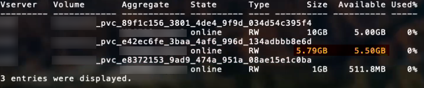

= Options et exemples de configuration SAN ONTAP
:hardbreaks:
:allow-uri-read: 
:icons: font
:imagesdir: ../media/

[role="lead"]
Découvrez comment créer et utiliser des pilotes SAN ONTAP avec votre installation Trident. Cette section fournit des exemples de configuration backend et des détails pour le mappage des backends à StorageClasses. link:https://docs.netapp.com/us-en/asa-r2/get-started/learn-about.html["Systèmes ASA r2"^] diffèrent des autres systèmes ONTAP (ASA, AFF et FAS) par l’implémentation de leur couche de stockage. Ces variations ont un impact sur l’utilisation de certains paramètres comme noté. link:https://docs.netapp.com/us-en/asa-r2/learn-more/hardware-comparison.html["En savoir plus sur les différences entre les systèmes ASA r2 et les autres systèmes ONTAP"^]. Dans la configuration du backend Trident, il n'est pas nécessaire de préciser que votre système est ASA r2. Lorsque vous sélectionnez  `ontap-san` comme  `storageDriverName`, Trident détecte automatiquement les systèmes ASA r2 ou autres systèmes ONTAP. Certains paramètres de configuration du backend ne s'appliquent pas aux systèmes ASA r2, comme indiqué dans le tableau ci-dessous.

NOTE: Seul le  `ontap-san`pilote (avec les protocoles iSCSI, NVMe/TCP et FC) est pris en charge pour les systèmes ASA r2.

[[backend-configuration-options]]
== Options de configuration du backend

Consultez le tableau suivant pour les options de configuration du backend :

[cols="1,3,2"]
|===
| Paramètre | Description | Défaut 

| `version` |  | Toujours 1 

| `storageDriverName` | Nom du pilote de stockage | `ontap-san` ou `ontap-san-economy` 

| `backendName` | Nom personnalisé ou le stockage backend | Nom du pilote + "_" + dataLIF 

| `managementLIF`  a| 
Adresse IP d'une LIF de gestion de cluster ou de SVM.

Un nom de domaine complet (FQDN) peut être spécifié.

Il est possible de configurer l’utilisation d’adresses IPv6 si Trident a été installé avec l’option IPv6. Les adresses IPv6 doivent être définies entre crochets, comme  `[28e8:d9fb:a825:b7bf:69a8:d02f:9e7b:3555]`.

Pour une transition en douceur MetroCluster, consultez le <<mcc-best>>.

NOTE: Si vous utilisez les identifiants « vsadmin »,  `managementLIF` doit être celui de la SVM ; si vous utilisez les identifiants « admin »,  `managementLIF` doit être celui du cluster.
| "10.0.0.1", "[2001:1234:abcd::fefe]" 

| `dataLIF` | Adresse IP de l’interface logique de protocole (LIF). Il est possible de configurer l’utilisation d’adresses IPv6 si Trident a été installé avec l’option IPv6. Les adresses IPv6 doivent être définies entre crochets, comme  `[28e8:d9fb:a825:b7bf:69a8:d02f:9e7b:3555]`. *Ne pas spécifier pour iSCSI.* Trident utilise link:https://docs.netapp.com/us-en/ontap/san-admin/selective-lun-map-concept.html["Mappage LUN sélectif ONTAP"^] pour découvrir les LIF iSCSI nécessaires à l’établissement d’une session multi-chemin. Un avertissement est généré si  `dataLIF` est explicitement défini. *Omettre pour MetroCluster.* Voir le <<mcc-best>>. | Dérivé par le SVM 

| `svm` | Machine virtuelle de stockage à utiliser *Omettre pour MetroCluster.* Voir le <<mcc-best>>. | Dérivé si un SVM `managementLIF` est spécifié 

| `useCHAP` | Utilisez CHAP pour authentifier iSCSI pour les pilotes SAN ONTAP [paramètre booléen]. Définissez sur  `true` pour que Trident configure et utilise CHAP bidirectionnel comme authentification par défaut pour la SVM indiquée dans le backend. Consultez link:ontap-san-prep.html["Préparez-vous à configurer le backend avec les pilotes SAN ONTAP"] pour plus de détails. *Non pris en charge pour FCP ou NVMe/TCP.* | `false` 

| `chapInitiatorSecret` | Secret de l'initiateur CHAP. Obligatoire si `useCHAP=true` | "" 

| `labels` | Ensemble d'étiquettes arbitraires au format JSON à appliquer aux volumes | "" 

| `chapTargetInitiatorSecret` | Secret de l'initiateur de la cible CHAP. Obligatoire si `useCHAP=true` | "" 

| `chapUsername` | Nom d'utilisateur entrant. Obligatoire si `useCHAP=true` | "" 

| `chapTargetUsername` | Nom d'utilisateur cible. Obligatoire si `useCHAP=true` | "" 

| `clientCertificate` | Valeur encodée en Base64 du certificat client. Utilisé pour l'authentification par certificat | "" 

| `clientPrivateKey` | Valeur encodée en Base64 de la clé privée du client. Utilisé pour l'authentification par certificat | "" 

| `trustedCACertificate` | Valeur encodée en Base64 du certificat d'autorité de certification de confiance. Facultatif. Utilisé pour l'authentification par certificat. | "" 

| `username` | Nom d'utilisateur requis pour communiquer avec le cluster ONTAP. Utilisé pour l'authentification par identifiants. Pour l'authentification Active Directory, voir link:../trident-use/ontap-san-examples.html#authenticate-trident-to-a-backend-svm-using-active-directory-credentials["Authentifier Trident auprès d'un SVM backend à l'aide des identifiants Active Directory"]. | "" 

| `password` | Mot de passe requis pour communiquer avec le cluster ONTAP. Utilisé pour l'authentification par identifiants. Pour l'authentification Active Directory, voir link:../trident-use/ontap-san-examples.html#authenticate-trident-to-a-backend-svm-using-active-directory-credentials["Authentifier Trident auprès d'un SVM backend à l'aide des identifiants Active Directory"]. | "" 

| `svm` | Machine virtuelle de stockage à utiliser | Dérivé si un SVM `managementLIF` est spécifié 

| `storagePrefix` | Préfixe utilisé lors du provisionnement de nouveaux volumes dans la SVM. Ne peut pas être modifié ultérieurement. Pour mettre à jour ce paramètre, vous devrez créer un nouveau backend. | `trident` 

| `aggregate`  a| 
Agrégat pour le provisionnement (facultatif ; s'il est défini, il doit être attribué à la SVM). Pour le  `ontap-nas-flexgroup` driver, cette option est ignorée. S'il n'est pas attribué, n'importe quel agrégat disponible peut être utilisé pour provisionner un FlexGroup volume.

NOTE: Lorsqu'un agrégat est mis à jour dans SVM, il est automatiquement mis à jour dans Trident par interrogation de SVM, sans qu'il soit nécessaire de redémarrer le contrôleur Trident. Si vous avez configuré un agrégat spécifique dans Trident pour provisionner des volumes, si l'agrégat est renommé ou déplacé hors de la SVM, le backend passera en état d'échec dans Trident lors de l'interrogation de l'agrégat SVM. Vous devez soit changer l'agrégat pour un qui est présent sur la SVM, soit le supprimer complètement pour remettre le backend en ligne.

*Ne pas spécifier pour les systèmes ASA r2*.
 a| 
""

| `limitAggregateUsage` | L'approvisionnement échoue si l'utilisation dépasse ce pourcentage. Si vous utilisez un Amazon FSx for NetApp ONTAP backend, ne spécifiez pas  `limitAggregateUsage`. Les  `fsxadmin` et  `vsadmin` fournis ne contiennent pas les autorisations requises pour récupérer l'utilisation agrégée et la limiter à l'aide de Trident. *Ne pas spécifier pour les systèmes ASA r2*. | "" (non appliqué par défaut) 

| `limitVolumeSize` | L'approvisionnement échoue si la taille du volume demandée dépasse cette valeur. Limite également la taille maximale des volumes qu'il gère pour les LUN. | "" (non appliqué par défaut) 

| `lunsPerFlexvol` | Nombre maximal de LUN par FlexVol®, doit être compris dans la plage [50, 200] | `100` 

| `debugTraceFlags` | Options de débogage à utiliser lors du dépannage. Exemple, {"api":false, "method":true} n’utilisez-les que si vous effectuez un dépannage et avez besoin d’un journal détaillé. | `null` 

| `useREST`  a| 
Paramètre booléen à utiliser pour les API REST ONTAP.

 `useREST` Lorsqu'il est défini sur `true`, Trident utilise les API REST ONTAP pour communiquer avec le backend ; lorsqu'il est défini sur `false`, Trident utilise les appels ONTAPI (ZAPI) pour communiquer avec le backend. Cette fonctionnalité nécessite ONTAP 9.11.1 ou une version ultérieure. De plus, le rôle de connexion ONTAP utilisé doit avoir accès à l'application  `ontapi`. Cela est satisfait par les rôles prédéfinis  `vsadmin` et  `cluster-admin`. À partir de la version Trident 24.06 et ONTAP 9.15.1 ou version ultérieure,  `useREST` est défini sur  `true` par défaut ; modifiez  `useREST` sur  `false` pour utiliser les appels ONTAPI (ZAPI).

`useREST` est entièrement compatible NVMe/TCP.

NOTE: NVMe est pris en charge uniquement avec les API REST ONTAP et non avec ONTAPI (ZAPI).

*Si spécifié, toujours définir sur  `true` pour les systèmes ASA r2*.
| `true` pour ONTAP 9.15.1 ou version ultérieure, sinon  `false`. 

 a| 
`sanType`
| Utilisez pour sélectionner  `iscsi` pour iSCSI,  `nvme` pour NVMe/TCP ou  `fcp` pour SCSI sur Fibre Channel (FC). | `iscsi` si vide 

| `formatOptions`  a| 
Utilisez  `formatOptions` pour spécifier des arguments de ligne de commandes pour la commande  `mkfs`, qui seront appliqués chaque fois qu’un volume est formaté. Cela vous permet de formater le volume selon vos préférences. Assurez-vous de spécifier les formatOptions similaires à celles des options de la commande mkfs, à l’exclusion du chemin du périphérique. Exemple : « -E nodiscard »

*Pris en charge pour  `ontap-san` et  `ontap-san-economy` pilotes avec le protocole iSCSI.* *En outre, pris en charge pour les systèmes ASA r2 lors de l'utilisation des protocoles iSCSI et NVMe/TCP.*
 a| 

| `limitVolumePoolSize` | Taille maximale requise de FlexVol lors de l'utilisation de LUN dans le backend ontap-san-economy. | "" (non appliqué par défaut) 

| `denyNewVolumePools` | Limite `ontap-san-economy` les backends à la création de nouveaux volumes FlexVol® pour contenir leurs LUN. Seuls les FlexVol® préexistants sont utilisés pour le provisionnement de nouveaux PV. |  
|===

[[recommendations-for-using-formatoptions]]
=== Recommandations d'utilisation de formatOptions

Trident recommande les options suivantes pour accélérer le processus de mise en forme :

* *-E nodiscard (ext3, ext4) :* Ne pas tenter de supprimer des blocs lors de la création du système de fichiers (la suppression initiale de blocs est utile sur les disques SSD et les systèmes de stockage à provisionnement fin). Cette option remplace l'option obsolète « -K » et s'applique aux systèmes de fichiers ext3 et ext4.
* *-K (xfs) :* Ne pas tenter de supprimer des blocs lors de la création du système de fichiers (mkfs). Cette option s’applique au système de fichiers xfs.

[[authenticate-trident-to-a-backend-svm-using-active-directory-credentials]]
=== Authentifier Trident auprès d'un SVM backend à l'aide des identifiants Active Directory

Vous pouvez configurer Trident pour qu'il s'authentifie auprès d'une SVM backend à l'aide d'identifiants Active Directory (AD). Avant qu'un compte AD puisse accéder à la SVM, vous devez configurer l'accès des contrôleurs de domaine AD au cluster ou à la SVM. Pour l'administration du cluster avec un compte AD, vous devez créer un tunnel de domaine. Consultez link:https://docs.netapp.com/us-en/ontap/authentication/enable-ad-users-groups-access-cluster-svm-task.html["Configurer l'accès au contrôleur de domaine Active Directory dans ONTAP"^] pour plus de détails.

.étapes
. Configurer les paramètres du système de noms de domaine (DNS) pour une SVM backend :
+
`vserver services dns create -vserver <svm_name> -dns-servers <dns_server_ip1>,<dns_server_ip2>`

. Exécutez la commande suivante pour créer un compte d'ordinateur pour la SVM dans Active Directory :
+
`vserver active-directory create -vserver DataSVM -account-name ADSERVER1 -domain demo.netapp.com`

. Utilisez cette commande pour créer un utilisateur ou un groupe AD afin de gérer le cluster ou la SVM
+
`security login create -vserver <svm_name> -user-or-group-name <ad_user_or_group> -application <application> -authentication-method domain -role vsadmin`

. Dans le fichier de configuration backend de Trident, définissez les paramètres  `username` et  `password` sur le nom d'utilisateur ou de groupe AD et le mot de passe, respectivement.

[[backend-configuration-options-for-provisioning-volumes]]
== Options de configuration backend pour le provisionnement des volumes

Vous pouvez contrôler le provisionnement par défaut à l'aide de ces options dans la section  `defaults` de la configuration. Pour un exemple, consultez les exemples de configuration ci-dessous.

[cols="1,3,2"]
|===
| Paramètre | Description | Défaut 

| `spaceAllocation` | Allocation d'espace pour les LUNs | "true" *Si spécifié, définissez sur  `true` pour les systèmes ASA r2*. 

| `spaceReserve` | Mode de réservation d'espace : « aucun » (fin) ou « volume » (épais). *À définir sur  `none` pour les systèmes ASA r2*. | "none" 

| `snapshotPolicy` | Stratégie d'instantané à utiliser. *À définir sur  `none` pour les systèmes ASA r2*. | "none" 

| `qosPolicy` | Groupe de règles QoS à attribuer aux volumes créés. Choisissez l'un de qosPolicy ou adaptiveQosPolicy par pool de stockage/backend. L'utilisation des groupes de règles QoS avec Trident requiert ONTAP 9.8 ou une version ultérieure. Vous devez utiliser un groupe de règles QoS non partagé et vous assurer que le groupe de règles est appliqué individuellement à chaque composant. Un groupe de règles QoS partagé impose une limite au débit total de toutes les charges de travail. | "" 

| `adaptiveQosPolicy` | Groupe de règles QoS adaptatives à attribuer aux volumes créés. Choisissez l’un des deux, qosPolicy ou adaptiveQosPolicy, par pool de stockage/backend | "" 

| `snapshotReserve` | Pourcentage du volume réservé aux snapshots. *Ne pas spécifier pour les systèmes ASA r2*. | "0" si  `snapshotPolicy` est "aucun", sinon "" 

| `splitOnClone` | Séparer un clone de son parent lors de sa création | "false" 

| `encryption` | Activez le chiffrement de volume NetApp (NVE) sur le nouveau volume ; la valeur par défaut est  `false`. NVE doit être sous licence et activé sur le cluster pour utiliser cette option. Si NAE est activé sur le backend, tout volume provisionné dans Trident sera activé pour NAE. Pour plus d'informations, consultez : link:../trident-reco/security-reco.html["Comment Trident fonctionne avec NVE et NAE"]. | "false" *Si spécifié, définissez sur  `true` pour les systèmes ASA r2*. 

| `luksEncryption` | Activez le chiffrement LUKS. Consultez link:../trident-reco/security-luks.html["Utilisez Linux Unified Key Setup (LUKS)"]. | "" *Définir sur `false` pour les systèmes ASA r2*. 

| `tieringPolicy` | Politique de hiérarchisation à utiliser « none » *Ne pas spécifier pour les systèmes ASA r2*. |  

| `nameTemplate` | Modèle pour créer des noms de volumes personnalisés. | "" 
|===

[[volume-provisioning-examples]]
=== Exemples de provisionnement de volumes

Voici un exemple avec des valeurs par défaut définies :

[source, yaml]
----
---
version: 1
storageDriverName: ontap-san
managementLIF: 10.0.0.1
svm: trident_svm
username: admin
password: <password>
labels:
  k8scluster: dev2
  backend: dev2-sanbackend
storagePrefix: alternate-trident
debugTraceFlags:
  api: false
  method: true
defaults:
  spaceReserve: volume
  qosPolicy: standard
  spaceAllocation: 'false'
  snapshotPolicy: default
  snapshotReserve: '10'

----

NOTE: Pour tous les volumes créés à l'aide du  `ontap-san` driver, Trident ajoute 10 % de capacité supplémentaire à la FlexVol pour intégrer les métadonnées LUN. La LUN sera provisionnée avec la taille exacte demandée par l'utilisateur dans le PVC. Trident ajoute 10 % à la FlexVol (affiché comme taille disponible dans ONTAP). Les utilisateurs obtiendront désormais la capacité utilisable qu'ils ont demandée. Cette modification empêche également les LUN de devenir en lecture seule, sauf si l'espace disponible est entièrement utilisé. Ceci ne s'applique pas à ontap-san-economy.

Pour les backends qui définissent  `snapshotReserve`, Trident calcule la taille des volumes comme suit :

[listing]
----
Total volume size = [(PVC requested size) / (1 - (snapshotReserve percentage) / 100)] * 1.1
----
Le chiffre 1,1 correspond aux 10 % supplémentaires que Trident ajoute au FlexVol pour prendre en compte les métadonnées LUN. Pour  `snapshotReserve` = 5 %, et une demande PVC = 5 Gio, la taille totale du volume est de 5,79 Gio et la taille disponible est de 5,5 Gio. La commande  `volume show` devrait afficher des résultats similaires à cet exemple :

Actuellement, le redimensionnement est le seul moyen d'utiliser le nouveau calcul pour un volume existant.

[[minimal-configuration-examples]]
== Exemples de configuration minimale

Les exemples suivants présentent des configurations de base qui laissent la plupart des paramètres par défaut. C'est la manière la plus simple de définir un backend.

NOTE: Si vous utilisez Amazon FSx sur NetApp ONTAP avec Trident, NetApp recommande de spécifier les noms DNS des LIF au lieu des adresses IP.

.Exemple SAN ONTAP
[%collapsible]
====
Il s'agit d'une configuration de base utilisant le  `ontap-san` driver.

[source, yaml]
----
---
version: 1
storageDriverName: ontap-san
managementLIF: 10.0.0.1
svm: svm_iscsi
labels:
  k8scluster: test-cluster-1
  backend: testcluster1-sanbackend
username: vsadmin
password: <password>
----
====
.Exemple MetroCluster
[#mcc-best%collapsible]
====
Vous pouvez configurer le backend pour éviter d'avoir à mettre à jour manuellement la définition du backend après le basculement et le retour en arrière pendant link:../trident-reco/backup.html#svm-replication-and-recovery["Réplication et récupération de SVM"].

Pour une transition et un retour en arrière sans heurt, spécifiez le SVM en utilisant  `managementLIF` et omettez les  `svm` paramètres. Par exemple :

[source, yaml]
----
version: 1
storageDriverName: ontap-san
managementLIF: 192.168.1.66
username: vsadmin
password: password
----
====
.Exemple d'économie SAN ONTAP
[%collapsible]
====
[source, yaml]
----
version: 1
storageDriverName: ontap-san-economy
managementLIF: 10.0.0.1
svm: svm_iscsi_eco
username: vsadmin
password: <password>
----
====
.Exemple d'authentification par certificat
[%collapsible]
====
Dans cet exemple de configuration de base `clientCertificate`, `clientPrivateKey`, et `trustedCACertificate` (facultatif, si vous utilisez une autorité de certification de confiance) sont renseignés dans `backend.json` et prennent respectivement les valeurs encodées en base64 du certificat client, de la clé privée et du certificat de l'autorité de certification de confiance.

[source, yaml]
----
---
version: 1
storageDriverName: ontap-san
backendName: DefaultSANBackend
managementLIF: 10.0.0.1
svm: svm_iscsi
useCHAP: true
chapInitiatorSecret: cl9qxIm36DKyawxy
chapTargetInitiatorSecret: rqxigXgkesIpwxyz
chapTargetUsername: iJF4heBRT0TCwxyz
chapUsername: uh2aNCLSd6cNwxyz
clientCertificate: ZXR0ZXJwYXB...ICMgJ3BhcGVyc2
clientPrivateKey: vciwKIyAgZG...0cnksIGRlc2NyaX
trustedCACertificate: zcyBbaG...b3Igb3duIGNsYXNz
----
====
.Exemples CHAP bidirectionnels
[%collapsible]
====
Ces exemples créent un backend avec  `useCHAP` défini sur  `true`.

.Exemple ONTAP SAN CHAP
[source, yaml]
----
---
version: 1
storageDriverName: ontap-san
managementLIF: 10.0.0.1
svm: svm_iscsi
labels:
  k8scluster: test-cluster-1
  backend: testcluster1-sanbackend
useCHAP: true
chapInitiatorSecret: cl9qxIm36DKyawxy
chapTargetInitiatorSecret: rqxigXgkesIpwxyz
chapTargetUsername: iJF4heBRT0TCwxyz
chapUsername: uh2aNCLSd6cNwxyz
username: vsadmin
password: <password>
----
.Exemple d'économie ONTAP SAN CHAP
[source, yaml]
----
---
version: 1
storageDriverName: ontap-san-economy
managementLIF: 10.0.0.1
svm: svm_iscsi_eco
useCHAP: true
chapInitiatorSecret: cl9qxIm36DKyawxy
chapTargetInitiatorSecret: rqxigXgkesIpwxyz
chapTargetUsername: iJF4heBRT0TCwxyz
chapUsername: uh2aNCLSd6cNwxyz
username: vsadmin
password: <password>
----
====
.Exemple NVMe/TCP
[%collapsible]
====
Vous devez disposer d'une SVM configurée avec NVMe sur votre backend ONTAP. Il s'agit d'une configuration de base pour NVMe/TCP.

[source, yaml]
----
---
version: 1
backendName: NVMeBackend
storageDriverName: ontap-san
managementLIF: 10.0.0.1
svm: svm_nvme
username: vsadmin
password: password
sanType: nvme
useREST: true
----
====
.Exemple de SCSI sur FC (FCP)
[%collapsible]
====
Vous devez disposer d'une SVM configurée avec FC sur votre backend ONTAP. Il s'agit d'une configuration de base du backend pour FC.

[source, yaml]
----
---
version: 1
backendName: fcp-backend
storageDriverName: ontap-san
managementLIF: 10.0.0.1
svm: svm_fc
username: vsadmin
password: password
sanType: fcp
useREST: true
----
====
.Exemple de configuration du backend avec nameTemplate
[%collapsible]
====
[source, yaml]
----
---
version: 1
storageDriverName: ontap-san
backendName: ontap-san-backend
managementLIF: <ip address>
svm: svm0
username: <admin>
password: <password>
defaults:
  nameTemplate: "{{.volume.Name}}_{{.labels.cluster}}_{{.volume.Namespace}}_{{.vo\
    lume.RequestName}}"
labels:
  cluster: ClusterA
  PVC: "{{.volume.Namespace}}_{{.volume.RequestName}}"
----
====
.formatOptions exemple pour le pilote ontap-san-economy
[%collapsible]
====
[source, yaml]
----
---
version: 1
storageDriverName: ontap-san-economy
managementLIF: ""
svm: svm1
username: ""
password: "!"
storagePrefix: whelk_
debugTraceFlags:
  method: true
  api: true
defaults:
  formatOptions: -E nodiscard
----
====

[[examples-of-backends-with-virtual-pools]]
== Exemples de backends avec pools virtuels

Dans ces exemples de fichiers de définition de backend, des valeurs par défaut spécifiques sont définies pour tous les pools de stockage, comme  `spaceReserve` à aucun,  `spaceAllocation` à faux, et  `encryption` à faux. Les pools virtuels sont définis dans la section storage.

Trident définit les étiquettes de provisionnement dans le champ « Commentaires ». Les commentaires sont définis sur le volume FlexVol. Trident copie toutes les étiquettes présentes sur un pool virtuel vers le volume de stockage lors du provisionnement. Pour plus de simplicité, les administrateurs de stockage peuvent définir des étiquettes par pool virtuel et regrouper les volumes par étiquette.

Dans ces exemples, certains pools de stockage définissent leurs propres  `spaceReserve`,  `spaceAllocation`, et  `encryption` valeurs, et certains pools remplacent les valeurs par défaut.

.Exemple SAN ONTAP
[%collapsible]
====
[source, yaml]
----
---
version: 1
storageDriverName: ontap-san
managementLIF: 10.0.0.1
svm: svm_iscsi
useCHAP: true
chapInitiatorSecret: cl9qxIm36DKyawxy
chapTargetInitiatorSecret: rqxigXgkesIpwxyz
chapTargetUsername: iJF4heBRT0TCwxyz
chapUsername: uh2aNCLSd6cNwxyz
username: vsadmin
password: <password>
defaults:
  spaceAllocation: "false"
  encryption: "false"
  qosPolicy: standard
labels:
  store: san_store
  kubernetes-cluster: prod-cluster-1
region: us_east_1
storage:
  - labels:
      protection: gold
      creditpoints: "40000"
    zone: us_east_1a
    defaults:
      spaceAllocation: "true"
      encryption: "true"
      adaptiveQosPolicy: adaptive-extreme
  - labels:
      protection: silver
      creditpoints: "20000"
    zone: us_east_1b
    defaults:
      spaceAllocation: "false"
      encryption: "true"
      qosPolicy: premium
  - labels:
      protection: bronze
      creditpoints: "5000"
    zone: us_east_1c
    defaults:
      spaceAllocation: "true"
      encryption: "false"

----
====
.Exemple d'économie SAN ONTAP
[%collapsible]
====
[source, yaml]
----
---
version: 1
storageDriverName: ontap-san-economy
managementLIF: 10.0.0.1
svm: svm_iscsi_eco
useCHAP: true
chapInitiatorSecret: cl9qxIm36DKyawxy
chapTargetInitiatorSecret: rqxigXgkesIpwxyz
chapTargetUsername: iJF4heBRT0TCwxyz
chapUsername: uh2aNCLSd6cNwxyz
username: vsadmin
password: <password>
defaults:
  spaceAllocation: "false"
  encryption: "false"
labels:
  store: san_economy_store
region: us_east_1
storage:
  - labels:
      app: oracledb
      cost: "30"
    zone: us_east_1a
    defaults:
      spaceAllocation: "true"
      encryption: "true"
  - labels:
      app: postgresdb
      cost: "20"
    zone: us_east_1b
    defaults:
      spaceAllocation: "false"
      encryption: "true"
  - labels:
      app: mysqldb
      cost: "10"
    zone: us_east_1c
    defaults:
      spaceAllocation: "true"
      encryption: "false"
  - labels:
      department: legal
      creditpoints: "5000"
    zone: us_east_1c
    defaults:
      spaceAllocation: "true"
      encryption: "false"

----
====
.Exemple NVMe/TCP
[%collapsible]
====
[source, yaml]
----
---
version: 1
storageDriverName: ontap-san
sanType: nvme
managementLIF: 10.0.0.1
svm: nvme_svm
username: vsadmin
password: <password>
useREST: true
defaults:
  spaceAllocation: "false"
  encryption: "true"
storage:
  - labels:
      app: testApp
      cost: "20"
    defaults:
      spaceAllocation: "false"
      encryption: "false"

----
====

[[map-backends-to-storageclasses]]
== Map backends vers StorageClasses

Les définitions suivantes de StorageClass se réfèrent à <<Exemples de backends avec pools virtuels>>. En utilisant le champ  `parameters.selector`, chaque StorageClass indique quels pools virtuels peuvent être utilisés pour héberger un volume. Le volume possédera les aspects définis dans le pool virtuel choisi.

* Le `protection-gold` StorageClass sera associé au premier pool virtuel dans le `ontap-san` backend. Il s'agit du seul pool offrant une protection de niveau or.
+
[source, yaml]
----
apiVersion: storage.k8s.io/v1
kind: StorageClass
metadata:
  name: protection-gold
provisioner: csi.trident.netapp.io
parameters:
  selector: "protection=gold"
  fsType: "ext4"
----
* Le `protection-not-gold` StorageClass sera associé aux deuxième et troisième pools virtuels dans `ontap-san` backend. Ce sont les seuls pools offrant un niveau de protection autre que gold.
+
[source, yaml]
----
apiVersion: storage.k8s.io/v1
kind: StorageClass
metadata:
  name: protection-not-gold
provisioner: csi.trident.netapp.io
parameters:
  selector: "protection!=gold"
  fsType: "ext4"
----
* Le `app-mysqldb` StorageClass correspondra au troisième pool virtuel dans le `ontap-san-economy` backend. Il s'agit du seul pool offrant une configuration de pool de stockage pour l'app de type mysqldb.
+
[source, yaml]
----
apiVersion: storage.k8s.io/v1
kind: StorageClass
metadata:
  name: app-mysqldb
provisioner: csi.trident.netapp.io
parameters:
  selector: "app=mysqldb"
  fsType: "ext4"
----
* Le `protection-silver-creditpoints-20k` StorageClass sera associé au deuxième pool virtuel dans `ontap-san` backend. Il s'agit du seul pool offrant une protection de niveau argent et 20000 points de crédit.
+
[source, yaml]
----
apiVersion: storage.k8s.io/v1
kind: StorageClass
metadata:
  name: protection-silver-creditpoints-20k
provisioner: csi.trident.netapp.io
parameters:
  selector: "protection=silver; creditpoints=20000"
  fsType: "ext4"
----
* Le  `creditpoints-5k` StorageClass sera associé au troisième pool virtuel dans le  `ontap-san` backend et au quatrième pool virtuel dans le  `ontap-san-economy` backend. Ce sont les seuls pools proposant 5000 points de crédit.
+
[source, yaml]
----
apiVersion: storage.k8s.io/v1
kind: StorageClass
metadata:
  name: creditpoints-5k
provisioner: csi.trident.netapp.io
parameters:
  selector: "creditpoints=5000"
  fsType: "ext4"
----
* Le `my-test-app-sc` StorageClass sera associé au `testAPP` pool virtuel dans le `ontap-san` pilote avec `sanType: nvme`. C'est le seul pool offrant `testApp`.
+
[source, yaml]
----
---
apiVersion: storage.k8s.io/v1
kind: StorageClass
metadata:
  name: my-test-app-sc
provisioner: csi.trident.netapp.io
parameters:
  selector: "app=testApp"
  fsType: "ext4"
----

Trident déterminera quel pool virtuel est sélectionné et s'assurera que l'exigence de stockage est respectée.
