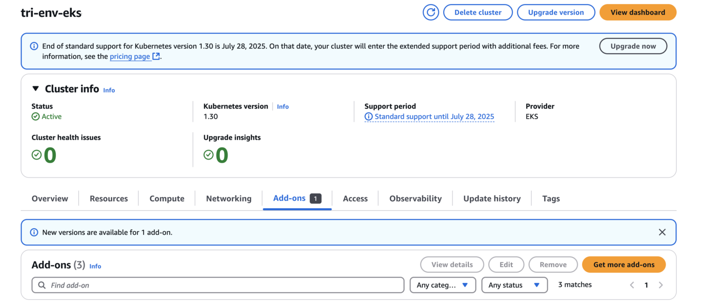
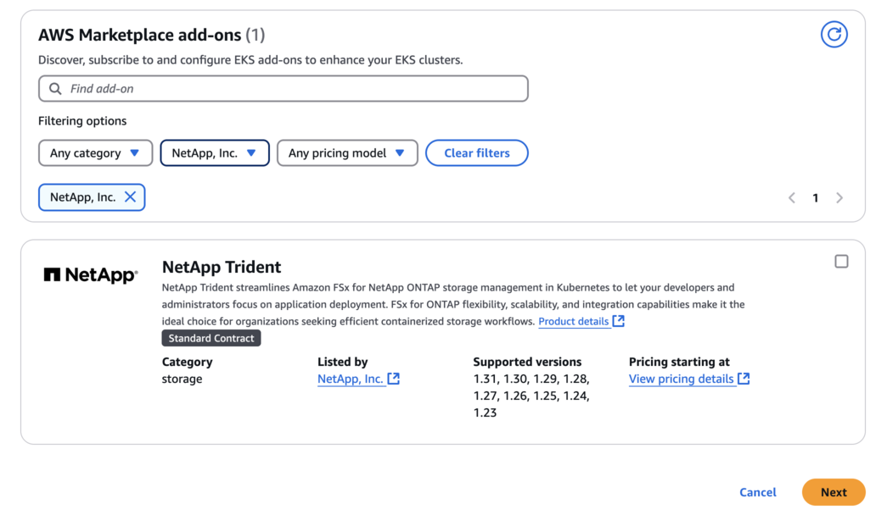
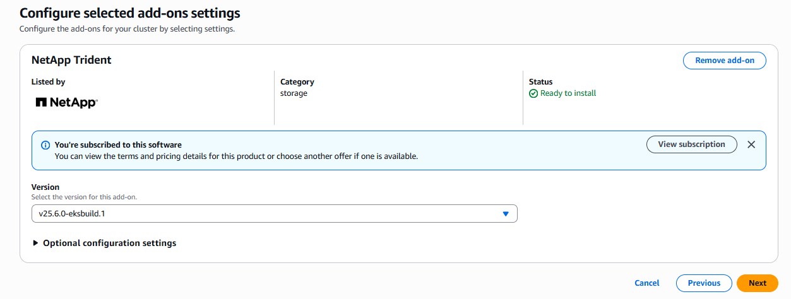
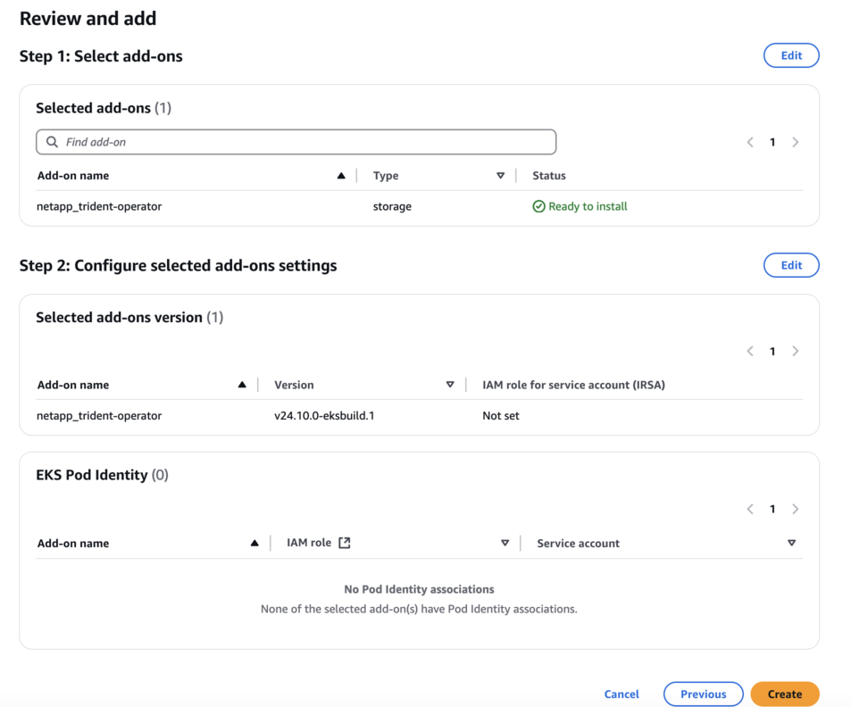
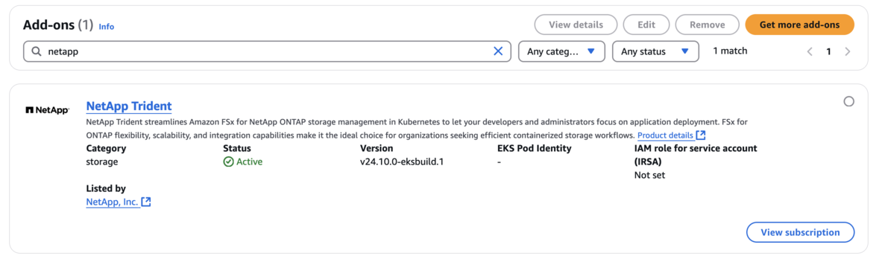

= Configurez le module complémentaire Trident EKS sur un cluster EKS
:hardbreaks:
:allow-uri-read: 
:icons: font
:imagesdir: ../media/

[role="lead"]
NetApp Trident simplifie la gestion du stockage Amazon FSx for NetApp ONTAP dans Kubernetes afin de permettre à vos développeurs et administrateurs de se concentrer sur le déploiement des applications. L’add-on NetApp Trident EKS inclut les derniers correctifs de sécurité, les corrections de bogues, et est validé par AWS pour fonctionner avec Amazon EKS. L’add-on EKS vous permet de garantir de manière cohérente que vos clusters Amazon EKS sont sécurisés et stables, et de réduire la quantité de travail nécessaire pour installer, configurer et mettre à jour les add-ons.

[[prerequisites]]
== Prérequis

Assurez-vous de disposer des éléments suivants avant de configurer le module complémentaire Trident pour AWS EKS :

* Un compte de cluster Amazon EKS disposant des autorisations nécessaires pour gérer les modules complémentaires. Consultez link:https://docs.aws.amazon.com/eks/latest/userguide/eks-add-ons.html["Modules complémentaires Amazon EKS"^].
* Autorisations AWS pour la AWS marketplace :
`"aws-marketplace:ViewSubscriptions",
"aws-marketplace:Subscribe",
"aws-marketplace:Unsubscribe`
* Type d'AMI : Amazon Linux 2 (AL2_x86_64) ou Amazon Linux 2 Arm(AL2_ARM_64)
* Type de nœud : AMD ou ARM
* Un système de fichiers Amazon FSx for NetApp ONTAP existant

[[steps]]
== Étapes

. Veillez à créer un rôle IAM et un secret AWS pour permettre aux pods EKS d'accéder aux ressources AWS. Pour obtenir des instructions, consultez link:../trident-use/trident-fsx-iam-role.html["Créez un rôle IAM et un secret AWS"^].
. Sur votre cluster Kubernetes EKS, accédez à l’onglet *Add-ons*.
+

. Accédez à *AWS Marketplace add-ons* et choisissez la catégorie _storage_.
+

. Repérez *NetApp Trident* et cochez la case de l’extension Trident, puis cliquez sur *Suivant*.
. Choisissez la version souhaitée du module complémentaire.
+

. Configurez les paramètres du module complémentaire requis.
+

. Si vous utilisez IRSA (IAM roles for service account), reportez-vous aux étapes de configuration supplémentaires link:https://docs.netapp.com/us-en/trident/trident-use/trident-fsx-install-trident.html#enable-the-trident-add-on-for-aws["ici"].
. Sélectionnez *Create*.
. Vérifiez que le statut du module complémentaire est _Active_.
+

. Exécutez la commande suivante pour vérifier que Trident est correctement installé sur le cluster :
+
[listing]
----
kubectl get pods -n trident
----
. Poursuivez l'installation et configurez le stockage backend. Pour plus d'informations, consultez link:trident-fsx-storage-backend.html["Configurer le backend de stockage"].

[[installuninstall-the-trident-eks-add-on-using-cli]]
== Installez/désinstallez l’add-on Trident EKS à l’aide de la CLI

.Installez le module complémentaire NetApp Trident EKS à l'aide de l'interface de ligne de commande :
La commande suivante installe le module complémentaire Trident EKS :
`eksctl create addon --cluster clusterName --name netapp_trident-operator --version v25.6.0-eksbuild.1` (avec une version dédiée)

L'exemple de commande suivant installe le Trident EKS add-on version 25.6.1 :
`eksctl create addon --cluster clusterName --name netapp_trident-operator --version v25.6.1-eksbuild.1` (avec une version dédiée)

L'exemple de commande suivant installe le Trident EKS add-on version 25.6.2 :
`eksctl create addon --cluster clusterName --name netapp_trident-operator --version v25.6.2-eksbuild.1` (avec une version dédiée)

.Désinstallez le module complémentaire NetApp Trident EKS à l'aide de l'interface de ligne de commande :
La commande suivante désinstalle le module complémentaire Trident EKS :

[listing]
----
eksctl delete addon --cluster K8s-arm --name netapp_trident-operator
----